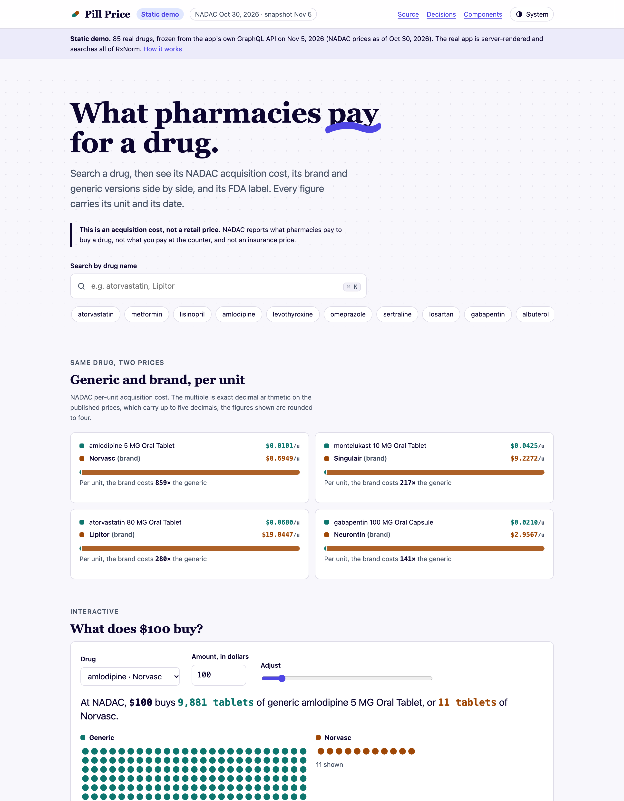
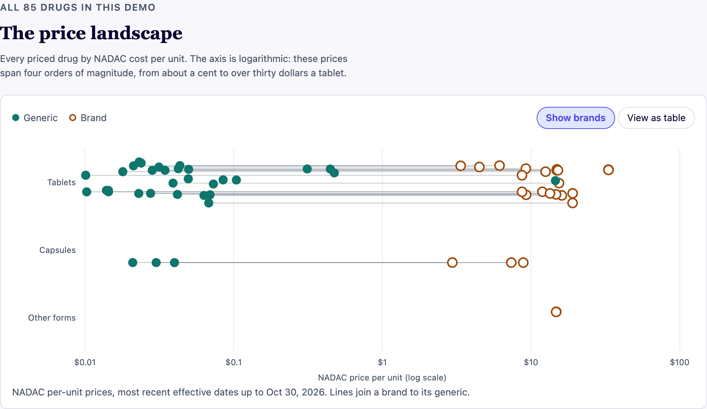
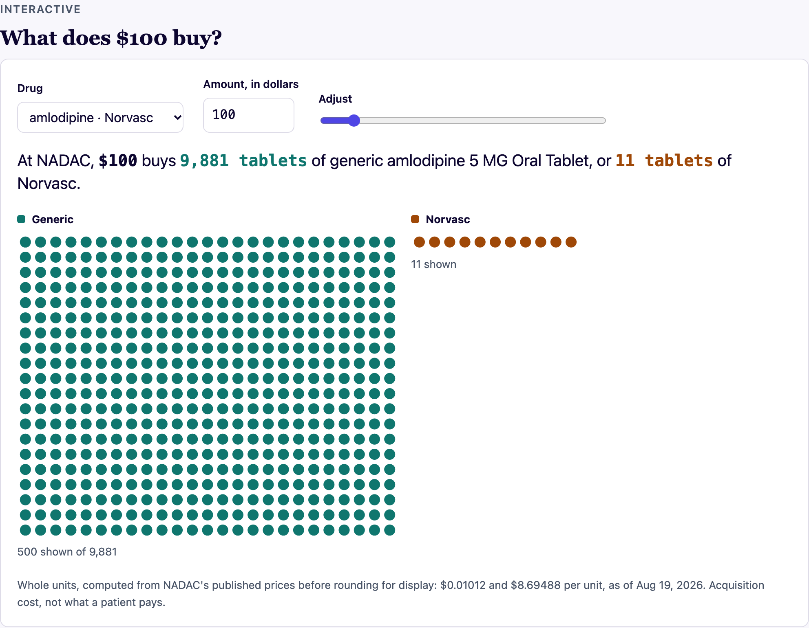
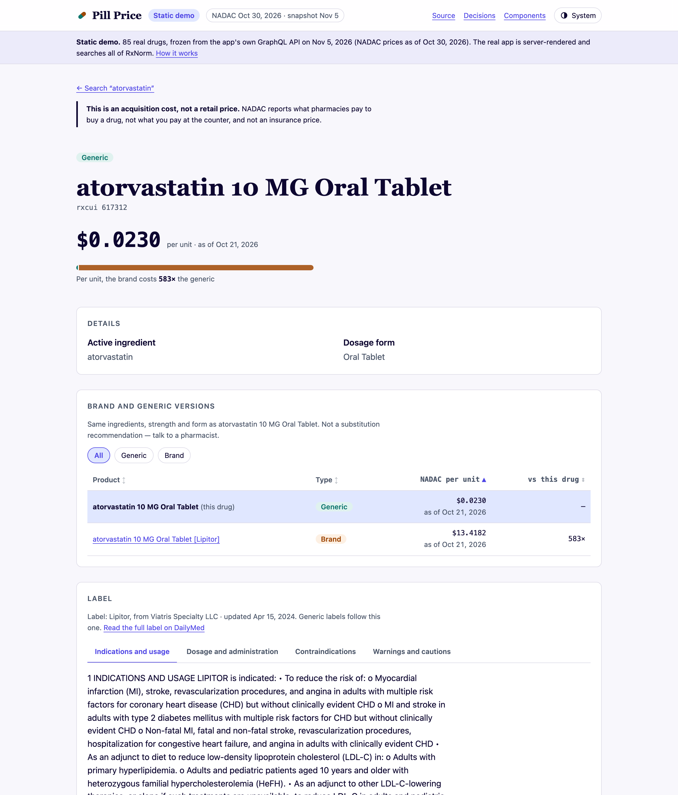
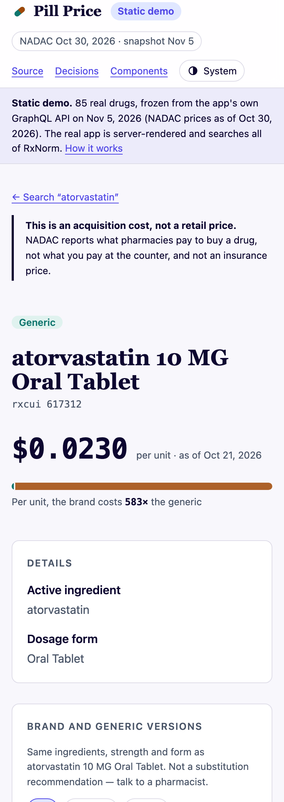
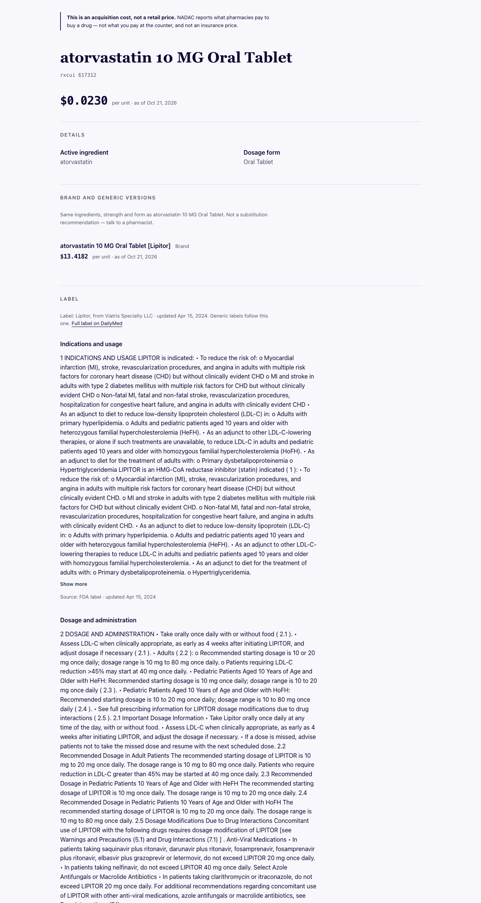
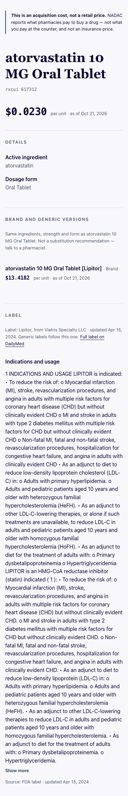
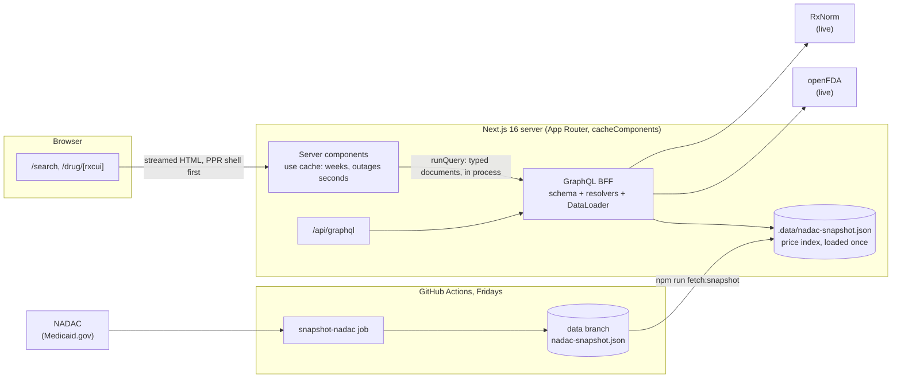

# Pill Price

A drug-pricing reference built on RxNorm, openFDA, and NADAC.

**NADAC reports what pharmacies pay to acquire a drug.** It is not what a
patient pays at the counter and it is not an insurance price. Every figure in
this app is labelled accordingly — see [`docs/ui-spec.md`](docs/ui-spec.md) §9.

## What it is

Search a drug by name, open it, and see what pharmacies pay for it (NADAC),
what it is (RxNorm), its brand and generic versions with their own prices, and
its FDA label (openFDA). Every price carries its unit and its date. Every
missing value says which source is missing it and whether that is a fact
("NADAC doesn't publish a cost for this drug") or a failure ("We couldn't
load price data. This is on our side, not NADAC's").

**Status: finished, 2026-11-05.** Two routes shipped: `/search` and
`/drug/[rxcui]`. **The app itself is not hosted,** but there is a
**[static demo on GitHub Pages](https://efriedla.github.io/Pill-Price/)**: 85
real drugs, frozen from the app's own GraphQL API, searchable and clickable.
For the real thing, [run it locally](#run-it-locally).
What was cut, and why, is in
[ADR-013](docs/adr/013-scope-under-schedule.md#amendment-2026-11-05-close-out)
and the [roadmap](docs/roadmap.md).

### The demo · [efriedla.github.io/Pill-Price](https://efriedla.github.io/Pill-Price/)

<picture><source media="(prefers-color-scheme: dark)" srcset="docs/demo-screenshots/home-dark.png"></picture>

<table>
<tr>
<td width="50%"><picture><source media="(prefers-color-scheme: dark)" srcset="docs/demo-screenshots/landscape-dark.png"></picture><br><sub><b>The price landscape.</b> Every drug on a log axis, each brand on its generic's row, so the line is the gap. Every dot is a link, and there is a table view.</sub></td>
<td width="50%"><picture><source media="(prefers-color-scheme: dark)" srcset="docs/demo-screenshots/buy-dark.png"></picture><br><sub><b>What does $100 buy?</b> Exact decimal arithmetic on the published prices ($0.01012 and $8.69488), never a float.</sub></td>
</tr>
<tr>
<td width="50%"><picture><source media="(prefers-color-scheme: dark)" srcset="docs/demo-screenshots/drug-dark.png"></picture><br><sub><b>A drug page.</b> Sortable, filterable versions with multiples, and the FDA label in tabs.</sub></td>
<td width="50%" align="center"><picture><source media="(prefers-color-scheme: dark)" srcset="docs/demo-screenshots/drug-mobile-dark.png"></picture><br><sub><b>At phone width</b>, light and dark (follows your GitHub theme).</sub></td>
</tr>
</table>

Dark mode, a ⌘K typeahead, and keyboard support throughout. axe-core finds 0
violations in light and dark; Lighthouse mobile scores performance 100 and
accessibility 100. The demo is a static page over 85 real drugs frozen from
the app's API ([`demo/`](demo/)), redesigned from
[`docs/design/demo-redesign.md`](docs/design/demo-redesign.md).

### The real app, from a production build

 

Every loading, empty and error state, at both widths, with how each was
forced: **[docs/screenshots](docs/screenshots/README.md)**.

## By the numbers

| | |
| --- | --- |
| BFF p95, cached drug | **22 ms** against a 200 ms budget ([performance.md](docs/performance.md)) |
| Lighthouse, desktop | 99–100 on every category |
| Lighthouse, mobile | performance 86–88; accessibility, best practices, SEO 100; CLS 0 (local production build, simulated throttling) |
| Keyboard | 93 tab stops on 7 pages, every one with a visible focus ring ([a11y-audit.md](docs/a11y-audit.md)) |
| Tests | 264 unit and component tests, plus Storybook stories run in real Chromium |
| Decisions | 12 accepted ADRs, each written before the code it authorized |

## Architecture



- **Pages query the BFF in process.** They run codegen'd GraphQL documents
  through `runQuery` inside `use cache` functions. An answer is cached for
  weeks; **an outage is cached for seconds**, so a failure is retried soon and
  never gets stuck in the cache
  ([ADR-001](docs/adr/001-rendering-strategy.md),
  [ADR-004](docs/adr/004-bff-and-schema-design.md)). `/api/graphql` exposes
  the same schema.
- **One drug is prerendered; every other drug gets an instant shell** and
  streams the rest, then is served static after its first visit
  ([ADR-005](docs/adr/005-static-dynamic-split.md)). Each of the page's three
  boundaries (price, versions, label) loads on its own. A wait past 1.5 s
  turns its skeleton into a small game (below).
- **NADAC is never on the request path.** A weekly job downloads all ~1M rows,
  keeps the latest price per NDC plus a quarterly series, and commits the file
  to the `data` branch ([ADR-009](docs/adr/009-nadac-on-the-request-path.md),
  [ADR-012](docs/adr/012-price-history-retention.md),
  [ADR-016](docs/adr/016-hosting-and-the-snapshot.md)).
- **Every failure has a type.** A field resolves to its value, to `Absent`
  (the source says there is none), or to `Unavailable` (we could not ask), and
  the page prints the server's sentence for each
  ([ADR-010](docs/adr/010-upstream-error-taxonomy.md)). Money is a decimal
  string end to end and is never a float.

## Run it locally

```bash
nvm use               # Node 24, per .nvmrc
npm ci
NADAC_SNAPSHOT_URL=https://raw.githubusercontent.com/efriedla/Pill-Price/data/nadac-snapshot.json \
  npm run fetch:snapshot   # the latest weekly prices, into .data/
npm run dev           # http://localhost:3000
npm run storybook     # http://localhost:6006
```

Without the snapshot the app still runs, and every price says "We couldn't
load price data". That is the honest state, not a crash. For production
numbers, use `npm run build:deploy && npm start` (with the same variable set).

The component library is also published: **[Storybook](https://efriedla.github.io/Pill-Price/storybook/)**, rebuilt on every merge to `main`.

The static demo lives in `demo/`. `npm run demo:data` refreezes its data from a
local production build, `npm run demo:screenshots` retakes the README images,
and `storybook-pages.yml` publishes it.

Evidence scripts, none in CI: `npm run screenshots`, `npm run lighthouse`,
`npm run keyboard-walk`, and `npm run rehearse:rollover` (the January NADAC
dataset change, against the live API).

## The loading games

Long waits have a mini game. Both cover a call that is genuinely in flight —
never an absent one, which is a settled fact and gets a plain statement instead
([ADR-010](docs/adr/010-upstream-error-taxonomy.md)).

| | | |
| --- | --- | --- |
| **Pill Shot** | canvas arcade | Drag back and release to shoot pills into the bottle. Keyboard: up/down aim, left/right set power, space shoots. |
| **Pill Sort** | SVG puzzle | Tap a bottle to pick up its top pills, tap another to drop them. Keyboard: left/right choose, Enter picks up and drops, U undoes. |

**Neither can be embedded here.** GitHub sanitizes HTML in markdown, so no
script, iframe or interactive canvas survives a README. Both are playable here,
with the source for each:

### ▶ [Play Pill Shot and Pill Sort](https://efriedla.github.io/demos/)

Or run them from a checkout:

```bash
npm run storybook     # then open UI/PillShotLoader or UI/PillSortLoader
```

Both honour `prefers-reduced-motion`. Pill Sort's pills carry an imprint as well
as two tones, so they are separable without colour, and every board it offers is
proved solvable before you see it.

## Checks

All five are required to merge ([`.github/workflows/ci.yml`](.github/workflows/ci.yml)).

```bash
npm run lint           # eslint, incl. module boundaries and the no-raw-hex rule
npm run typecheck      # tsc --noEmit, strict + noUncheckedIndexedAccess
npm run codegen:check  # generated GraphQL types still match the SDL
npm test               # vitest: unit (jsdom) + stories (real Chromium)
npm run build          # next build
```

`codegen:check` fails if `src/lib/gql/types.generated.ts` has drifted from the
schema. Run `npm run codegen` and commit the result; never hand-edit generated
output.

`npm test` runs two projects. `npm run test:unit` skips the browser when you
just want the fast loop.

## Layout

```
src/app/          routes, layouts, route handlers
src/server/       GraphQL BFF: schema, resolvers, upstream clients
src/features/     vertical slices: drug, search, compare
src/ui/           presentational primitives
src/lib/          types, formatters, tokens
src/lib/gql/      generated GraphQL types — the only thing features/ and
                  server/ share; regenerate with `npm run codegen`
docs/adr/         decision records — read before changing architecture
docs/sketches/    throwaway layout sketches against the real tokens
docs/ui-spec.md   field mapping, colour semantics, copy rules
docs/roadmap.md   the 8-week plan, closed with what shipped and what was cut
docs/screenshots/ every state of the real app, from a production build
docs/demo-screenshots/ the static demo, light and dark
tests/            repo-level tests (boundary enforcement)
```

Imports travel one way — `app → feature → ui → lib`, with `server → lib` — and
never sideways between slices. Default is deny, nothing imports `app`, and
features are reachable only through their `index.ts` barrel. Enforced by lint
and asserted by [`tests/boundaries.test.ts`](tests/boundaries.test.ts), which
fails if the config ever stops rejecting a violation.

## Design

The palette, type scale, and spacing live in
[`src/lib/tokens.css`](src/lib/tokens.css) — the only file permitted to contain
raw colour values. Two rules there are load-bearing and easy to undo by
accident:

- **Price direction is never encoded in colour.** Green-up/red-down means
  gain/loss in finance; on drug pricing the polarity is inverted and either
  mapping misleads. Direction is carried by a glyph and a sentence.
- **Colour is never the only signal.** Every colour-coded category also carries
  a text label, and the boxed-warning treatment combines hue, a 3px rule, an
  icon, and a bold label.

`docs/sketches/` holds static HTML sketches of the three routes. They link the
real token file rather than a copy, so they cannot drift from the palette. Open
them directly in a browser; nothing there ships.

## Data sources

| Source | Used for | Freshness |
| --- | --- | --- |
| RxNorm | drug identity, search, ingredients, dose form, brand and generic versions | live, cached per its `cacheLife` |
| openFDA | the label (the reference brand's, which generics follow; [ADR-015](docs/adr/015-what-label-is.md)) | live, cached |
| NADAC | acquisition cost per unit (EA, mL or gram) | weekly snapshot |

Every field's source, freshness and failure mode is in
[`docs/api-contract.md`](docs/api-contract.md).

## Limitations

Written honestly, and added to as they were discovered:

- **Pricing is acquisition cost, not what a patient pays.** The page says so
  above every price.
- **Not hosted.** The [static demo](https://efriedla.github.io/Pill-Price/) is
  frozen data with client-side search over 85 drugs, not the server-rendered
  app.
- **A new snapshot needs a restart,** and a drug page upgraded after its first
  visit is written to disk, so it keeps its old price until it is revalidated.
- **No price history is shown.** The quarterly series is stored and grows
  every week, but the chart was never built
  ([ADR-014](docs/adr/014-price-history-read-path.md) is still options only).
  Gaps in a series are real and would never be interpolated.
- **A drug's headline price is its cheapest package.** For about a third of
  multi-package drugs the packages disagree (median spread 9.9%).
- **Mobile LCP is ~2.5 s** under Lighthouse's simulated throttling, held back
  by script, not the server. Measured, not fixed.
- **No screen-reader pass;** six more known gaps are in the
  [a11y audit](docs/a11y-audit.md). Among them: no link back to search from a
  drug page, and the search box is blank while results load.
- **Compare, the composition bar and the drug-class section were cut**
  ([ADR-013](docs/adr/013-scope-under-schedule.md)).
- No auth, no accounts, no database: by design.

## Contributing

[`CONTRIBUTING.md`](CONTRIBUTING.md) covers the layer rules, the token rules,
and the process: an ADR before the code it authorizes, every change on a
branch, and a PR description written from memory with the diff closed.
